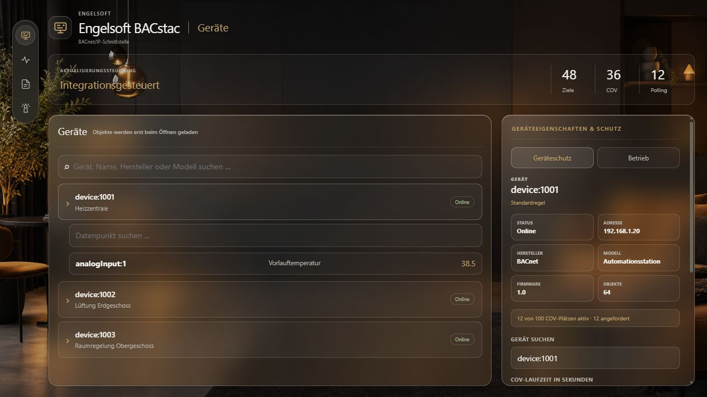

<!-- Modified by engelsofta in 2026 for Engelsoft BACstac; derived from the Bepacom BACnet/IP add-on. -->

# Engelsoft BACstac for Home Assistant

[](https://github.com/engelsofta/engelsoft-bacstac-ha-addon/releases/latest)
[](https://github.com/engelsofta/engelsoft-bacstac-ha-addon/actions/workflows/build.yaml)
[](LICENSE)

Engelsoft BACstac connects a BACnet/IP network to Home Assistant. The add-on
handles BACnet communication and exposes discovered devices, objects and value
changes through a local integration connection for **Engelsoft Beacon BACnet/IP**.

## Highlights

- **Automatic BACnet discovery:** Finds reachable BACnet/IP devices and reads
  their object inventory.
- **Safe value updates:** Starts with managed polling by default. Optional COV
  is limited per device, subscribed at a controlled pace and automatically
  falls back to polling when notifications stop arriving.
- **Transparent target status:** Shows the confirmed COV subscription, latest
  COV notification, latest poll and current value age for every object.
- **Integration-controlled hybrid mode:** Accepts COV, polling or disabled target
  modes from Engelsoft Beacon BACnet/IP while retaining COV limits, pacing and
  automatic fallbacks.
- **Reliable restarts:** A versioned and validated inventory cache makes the
  most recently completed object inventory available early after a restart.
- **Clear separation of responsibilities:** BACstac communicates with BACnet;
  Engelsoft Beacon BACnet/IP manages devices and entities in Home Assistant.
- **Matching Engelsoft design:** The same background images, smoky glass cards,
  typography and gold accents as the companion integration, with automatic
  light/dark mode and a responsive layout.
- **Ingress web interface:** Browse devices and objects, inspect COV/polling
  targets, manage EDE files and open the companion BACnet Explorer from the
  compact icon navigation. German and English follow the interface language.
- **BACnet writes:** Supports write requests with a configurable BACnet priority.
- **Flexible networking:** Supports normal BACnet/IP operation and foreign-device
  registration with a BBMD.
- **Localized configuration:** German, English and Dutch add-on configuration
  texts are included.
- **Current Home Assistant platforms:** Prebuilt images are available for
  `amd64` and `aarch64`, including current 64-bit Raspberry Pi installations.

## How the components work together

```text
BACnet/IP devices
       ↓
Engelsoft BACstac
  Discovery · Read/write · COV/polling · Cache · Diagnostics
       ↓
Engelsoft Beacon BACnet/IP
  Devices and entities in Home Assistant
```

The add-on intentionally does not create Home Assistant entities. That is the
responsibility of the **Engelsoft Beacon BACnet/IP** integration. This keeps
BACnet communication separate from Home Assistant's device and entity model.

## Web interface



*Preview with illustrative sample devices; actual devices and values depend on your network.*

Open **Web UI** from the add-on page. The icon navigation provides:

- **Devices:** Search devices, expand their objects and inspect current values.
  Select a device to review its properties and protection rules. The **Runtime**
  tab contains settings that apply without restarting the add-on.
- **Updates:** Inspect COV and polling status, filter and sort update targets,
  and manage individual COV subscriptions.
- **EDE files:** Upload EDE files and state texts, or remove selected imports.
- **BACnet Explorer:** Open the companion integration in Home Assistant.

Navigation sits on the left on desktop and moves above the content on narrow
screens. Background images are bundled with BACstac, so its appearance does not
depend on the integration's static files being available.

## Installation

1. Open **Settings → Apps → App store** in Home Assistant.
2. Open the app-store menu and select **Repositories**.
3. Add this custom repository:

   `https://github.com/engelsofta/engelsoft-bacstac-ha-addon`

4. Install **Engelsoft BACstac**.
5. Configure the BACnet/IP connection and start the add-on.
6. Set up [**Engelsoft Beacon BACnet/IP**](https://github.com/engelsofta/ha-bepacom-bacnet) in Home Assistant.

See the [add-on documentation](engelsoft_bacstac/DOCS.md) for detailed option
descriptions.

## Supported architectures

| Architecture | Typical systems |
| --- | --- |
| `amd64` | Home Assistant OS on Intel and AMD systems |
| `aarch64` | 64-bit ARM systems, including current Raspberry Pis |

The official Home Assistant build pipeline used by this project no longer
publishes 32-bit ARM target images.

## Releases and support

See [Releases](https://github.com/engelsofta/engelsoft-bacstac-ha-addon/releases)
and the [changelog](engelsoft_bacstac/CHANGELOG.md) for published changes.
Container images are built for every supported architecture and published to
GitHub Container Registry.

Before reporting a problem, check the add-on log and diagnostics view. Bugs and
reproducible enhancement requests are welcome in
[GitHub Issues](https://github.com/engelsofta/engelsoft-bacstac-ha-addon/issues).

## License and origin

Engelsoft BACstac is a substantially modified continuation of the
[Bepacom BACnet/IP add-on](https://github.com/Bepacom-Raalte/bepacom-HA-Addons).
It is distributed under the Apache License 2.0. The original [LICENSE](LICENSE),
origin notices and modified-file markings remain in place. See [NOTICE](NOTICE)
for further details.
